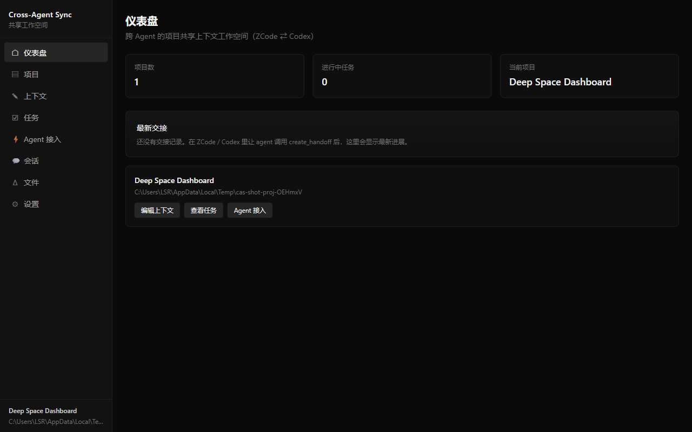
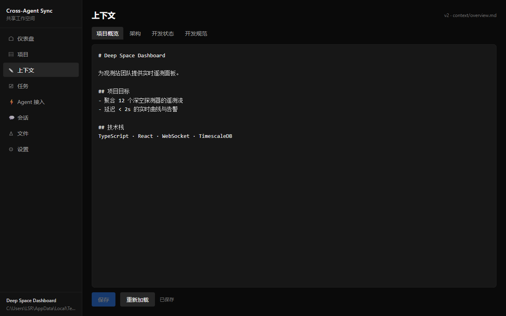
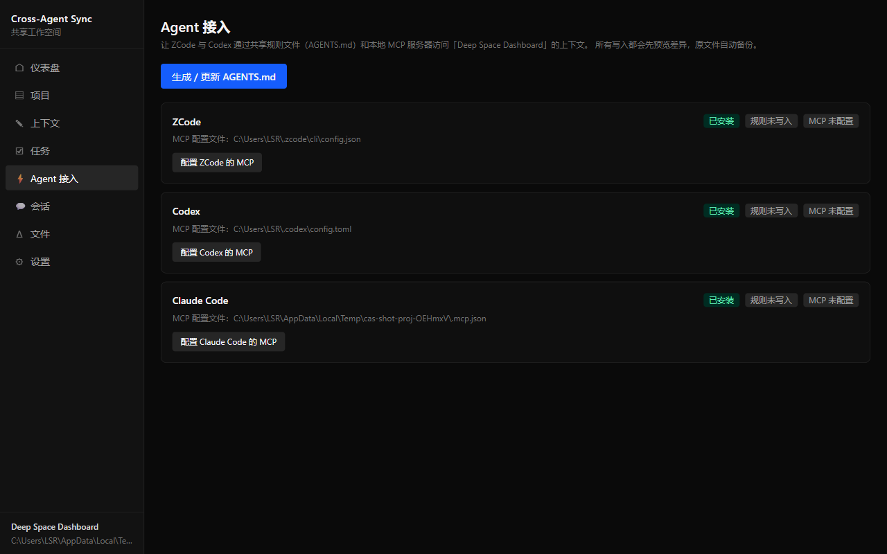
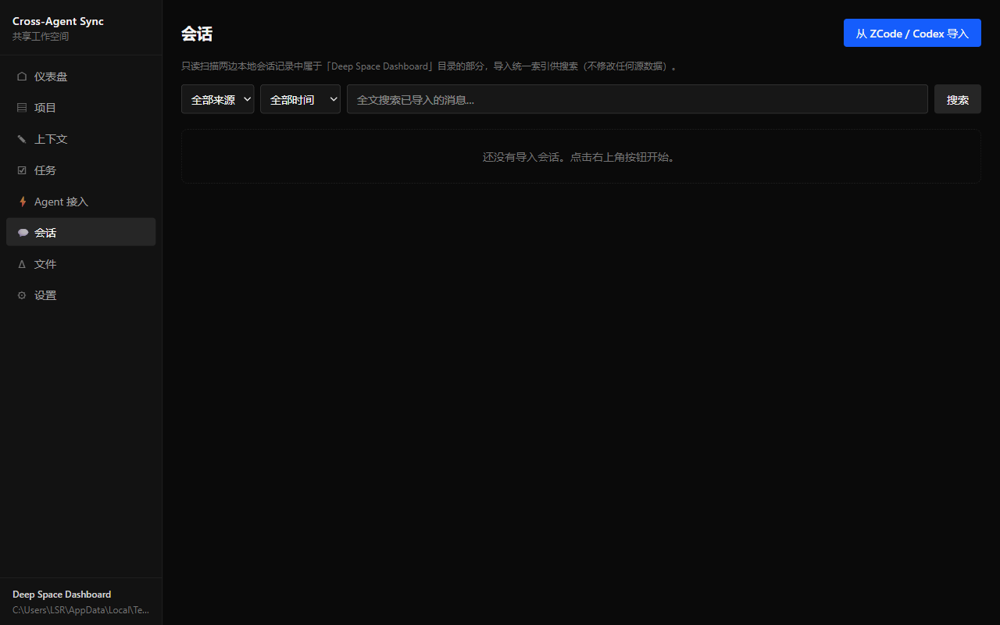

# Cross-Agent Sync

**Local-first shared workspace for AI coding agents — 一个项目，一份所有 Agent 共享的上下文。**

[中文说明](README.zh-CN.md) · [PRD](docs/PRD.md) · [架构](docs/ARCHITECTURE.md) · [路线图](docs/ROADMAP.md)

同时用 ZCode 和 Codex（后续支持更多 Agent）开发同一个项目时，每个工具各有一套会话、规则和上下文，切换就要重新解释一切。Cross-Agent Sync 在项目里维护一个独立于厂商的 `.agent-sync/` 共享上下文目录（Markdown，人可读、可进 Git），并通过本地 MCP Server 让每个 Agent 都能读取与更新项目知识、任务和交接记录——**Codex 里做完的事，ZCode 接着干**。

- 🧠 **Context Sync**：overview / architecture / development-state / rules / decisions / handoffs
- 🔍 **Conversation 导入**：把 ZCode 与 Codex 的本地会话导入统一索引，全文搜索（只读源，绝不写回）
- 📁 **Project 变化**：文件增删改事件 + Git 只读状态
- 🔒 **Local-first**：数据在本机；修改任何 Agent 配置前先备份、可恢复；导入内容视为不可信数据

## Screenshots

| Dashboard | Context editor |
|---|---|
|  |  |
| **Agent onboarding** | **Conversation search** |
|  |  |

Status: **Beta (v0.2.0-beta.1)**. Supports ZCode, Codex and Claude Code; adapter interfaces for more agents are reserved.

## Windows installer (Beta)

Download `cross-agent-sync-*-setup.exe` from [Releases](../../releases):

- **Unsigned build**: SmartScreen may warn on first run — "More info → Run anyway". If Smart App Control blocks it, verify the SHA-256 in the release notes and run from source (`pnpm dev`) for now. A signed build via SignPath is planned.
- Data lives in `%APPDATA%/Cross-Agent Sync/` — local only, no telemetry.

## Development

```bash
pnpm install
pnpm dev          # launch the desktop app
pnpm test         # vitest (12 packages)
pnpm typecheck && pnpm lint
pnpm --filter @cross-agent-sync/desktop e2e   # Playwright E2E (5 flows)
```

Requires Node ≥ 22 and pnpm 11.

## License

MIT
